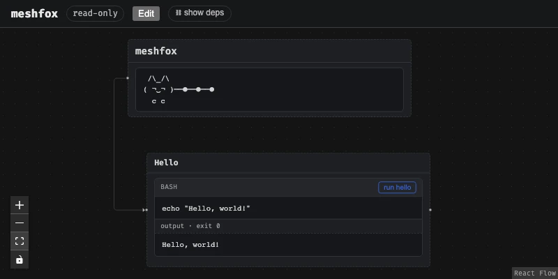
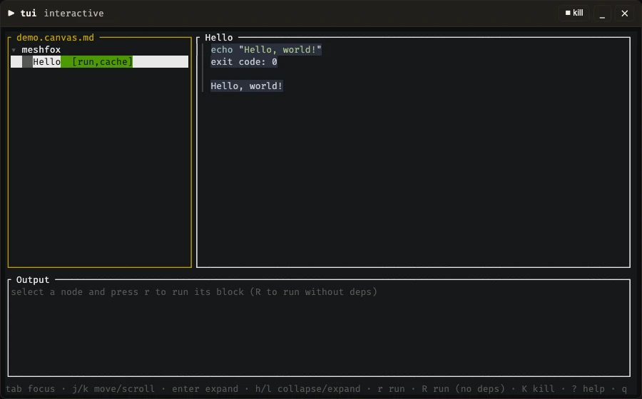

<!-- meshfox:canvas -->
# Interfaces
<!-- meshfox:node id="interfaces" -->

Part of the [meshfox documentation](./README.md). The ways to work with a canvas: browser UI and online editor, macOS menu-bar app, serving over HTTP, terminal UI, MCP server and the VS Code extension.

## Browser UI (`view`)
<!-- meshfox:node id="browser-ui-view" -->

`meshfox view` starts a small local web server and opens the canvas in the browser: the node tree laid out spatially, with run buttons on every runnable block. It opens read-only — running a block is always allowed (you're still explicitly clicking "run"), but a `cache`d block's output isn't written back to the file, and nodes can't be dragged/resized/saved, until "Edit" is clicked. Edit mode also unlocks the Auto-layout and ⚙ options toolbar buttons (see "Auto-layout" in [REFERENCE.canvas.md](./REFERENCE.canvas.md)) and the on-canvas node-settings modal. Output streams into the browser live as a block runs, not just once it's finished, and a running block gets a Kill button, for when one hangs. See "Interactive (`tty`) blocks" in [CLI.canvas.md](./CLI.canvas.md) for how a `tty`-flagged block behaves here instead — a floating terminal panel rather than inline output.

Syntax highlighting for fenced code blocks and `file`-node previews is [Shiki](https://shiki.style/) (read-only canvas view) and [Monaco](https://microsoft.github.io/monaco-editor/) (the node-body and Source-mode editors) — both built on the same `vscode-textmate`/TextMate-grammar engine VS Code itself uses, covering a large bundled language set out of the box. A language it doesn't bundle can be added the same way the terminal viewer's own custom grammars are (see "Terminal UI" below): drop a `.tmLanguage.json` (or `.sublime-syntax`, for the TUI side) file into `.meshfox/syntax/` next to the canvas, or `~/.meshfox/syntax/` globally — the server exposes it at `GET /api/syntax`/`GET /api/syntax/:name`, and both the browser UI and the terminal viewer read from the same one repository, not two independently-maintained lists.



```bash name="view-help" cache
meshfox view -h
```
<!-- meshfox:output name="view-help" -->
```text
exit code: 0

Start the local web UI: canvas view, run buttons. Opens read-only — running a block is always allowed, but click "Edit" in the browser to unlock dragging, resizing, saving layout, and persisting a `cache`d block's output back into the file

Usage: meshfox view [OPTIONS] [CANVAS]

Arguments:
  [CANVAS]  Path to the .canvas.md file. If omitted: auto-discover the single candidate in the current directory

Options:
      --canvas <CANVAS>  Same as the positional argument above, spelled as a flag — for parity with `run`/`node <op>`, which only accept this form
      --port <PORT>      Port to listen on. If omitted, a random free port is chosen — pass this explicitly to pin a stable port (e.g. for scripts) [default: 0]
      --no-open          Don't automatically open a browser tab
      --create           If the file doesn't exist yet, create it (same empty template as `create`) before opening it. Requires an explicit path — has nothing to auto-discover when the file isn't there yet. A no-op if the file already exists
      --no-auto-exit     Don't exit automatically once every browser tab connected to this server has closed. `meshfox view` is meant to run only as long as something's actually looking at it, so by default it exits a few seconds after the last tab goes away; pass this to keep it running headless instead (e.g. scripts/tests that cycle through pages with brief all-tabs-closed gaps a real user wouldn't have)
  -h, --help             Print help
```
<!-- /meshfox:output -->

## Online editor (in the browser)
<!-- meshfox:node id="online-editor-in-the-browser" -->

[meshfox-editor.orofarne.net](https://meshfox-editor.orofarne.net/) is the same web UI with no `meshfox` process behind it: the document model (`crates/model`, compiled to WebAssembly by `crates/wasm`) runs in the page and answers the UI's `api/...` requests itself, with the same edit and undo code the server uses. Open a `.canvas.md`, a whole folder (so includes, images, linked files and other canvases resolve) or drop either onto the page, or start a new canvas.

**Folders.** The root of the folder you pick or drop is the boundary a canvas reads within: one in a subdirectory shows `../docs/x.png` of that folder, and nothing above it is reachable.

**Packed canvases.** A packed canvas (`.canvas.tar.xz`, made by `meshfox pack`) opens like a folder: pick or drop the file, the whole pack is checked first, and its includes, images and linked canvases are all there. "download pack" hands back a new pack with your edits; the file you opened never changes.

**Privacy.** Files are read in the tab and never uploaded; there is no analytics. Unsaved edits are kept as a draft in the browser's own storage (IndexedDB) on that device, until you save, discard them or undo back to the saved text.

**What works.** Reading; Edit mode (node text, title, settings, arrows, layout, adding, moving and deleting nodes); Source mode for the whole file; undo, redo and the history list, for each canvas separately; `include`s, constraints and computed views; `file` nodes that link to another canvas of the opened folder (↗, Back and Forward move between them). Saving: "save" writes into a file you choose (Chromium browsers), "download" hands you the text anywhere else; nothing changes your original until you do.

**What does not.** Running blocks, forms, services, `display="table"` tables, link preview cards and editing the files a canvas includes — the page runs as `noexec`, like `meshfox --no-exec view`. Safari's folder picker leaves out dot-files, so a picked (not dropped) folder cannot honour `.meshfoxignore` there; a browser or privacy tool that locks `img.src`, `fetch` or `WebSocket` cannot run it and says so.

**Build and run it yourself.** With the `wasm-prep` block from "Unit tests" in [DEVELOPMENT.canvas.md](./DEVELOPMENT.canvas.md) done, `cd web && npm run build:wasm && npm run preview:wasm` serves it on `http://localhost:4600/`. The `editor-bundle` block under "Editor bundle" in [DEVELOPMENT.canvas.md](./DEVELOPMENT.canvas.md) (`meshfox DEVELOPMENT.canvas.md run editor-bundle`) builds the directory to upload (the site plus `_headers` with the Content-Security-Policy; Cloudflare Pages reads it as it is). The browser tests are the `wasm-editor` block under "End-to-end tests", the model's own the `wasm` block under "Unit tests" (both in [DEVELOPMENT.canvas.md](./DEVELOPMENT.canvas.md)). How it works, and its limits, in [web/wasm-editor/README.md](./web/wasm-editor/README.md).

### How the browser editor works
<!-- meshfox:node id="wasm-editor-readme" type="file" -->

[web/wasm-editor/README.md](./web/wasm-editor/README.md)

## macOS menu-bar app (`server_socket`, experimental)
<!-- meshfox:node id="macos-menu-bar-app-open-experimental" -->

`Meshfox.app` is a menu-bar-only daemon (no Dock icon) that also handles Finder's double-click/drag-onto-icon/"Open With" on a `.canvas.md` — see the "Building the macOS app" node below (it opens `macos/app.canvas.md`) for building it. The build produces `macos/dist/Meshfox.app`, a graphical `macos/dist/Meshfox.pkg`, and a ZIP containing the package and `Uninstall.command`. The package installs the app in `/Applications` for all users; each user gets a separate socket-activated daemon at login. It seeds `~/.local/bin/meshfox` once for each user, unless that user already has a CLI. The daemon uses that personal binary, which can be updated independently with `meshfox check-updates`, and falls back to the signed copy inside the app if needed. If `/usr/local/bin/meshfox` is free, the package puts a wrapper there that selects the calling user's binary; an existing command is preserved. New worker sessions use an updated CLI, while already running sessions must restart. A newer `.pkg` updates the app itself and refreshes active user agents without overwriting personal CLIs. Installing and uninstalling on another Mac requires neither the source tree nor the canvas file. The app is not built by default.

The current GitHub release workflow publishes standalone CLI tarballs, not `Meshfox.pkg`; package updates therefore require building or obtaining a newer package separately until the release workflow publishes one.

Once `server_socket` is set, every core-launch operation (`view`, `tui`, `run`, `node <op>`, `mcp`'s `debug_*`) becomes a client of whatever the daemon manages instead of spawning its own. `meshfox view <path>` in particular hands the canvas off to the daemon and exits immediately (prints a short confirmation) rather than starting a private session of its own — the daemon starts a worker for it if none exists yet, and opens a browser tab.

The daemon's own socket is always reachable once its LaunchAgent is installed — launchd itself creates and holds it open via socket activation, spawning (or waking) the actual daemon process on first connection rather than requiring it to already be running. No client anywhere (this CLI, the VS Code extension) needs to know how to find or launch the `.app` itself: a configured-but-unreachable `server_socket` means the LaunchAgent isn't installed at all, reported as a real error rather than a silent fallback to running standalone.

The menu-bar app is macOS only. On Linux, `meshfox serve` is the same coordinator without the UI — it speaks the same socket protocol, so `server_socket` points at it the same way. Run it by hand (`meshfox serve --socket PATH`) or under `systemd --user` socket activation (it takes the listening socket systemd hands it): `linux/install-user-units.sh [PATH_TO_MESHFOX]` installs `meshfox.socket` and `meshfox.service` for the current user and prints the `server_socket` line to add to `~/.meshfox/config.toml`; `--uninstall` removes them. The socket exists from login on and the first connection starts the service; stopping or killing the service leaves the socket in place and takes its workers down with it. It listens with owner-only permissions (`0600`), which is also what protects `kill`. Either coordinator is managed with `meshfox cores`: `list` (alias `ls`) lists the live cores (canvas path, port, pid), `open <canvas>` shows one in the browser (starting it if needed), `kill <canvas>` stops it (`no such core` if none is running).

### Building the macOS app
<!-- meshfox:node id="building-the-macos-app" type="file" -->

[macos/app.canvas.md](./macos/app.canvas.md)

## Serving canvases over HTTP (`meshfox serve --http`)
<!-- meshfox:node id="serve-http" -->

`meshfox serve --http [ADDR]` puts a small HTTP gateway in front of the coordinator, so a browser can reach canvases on a machine it has no direct line to — typically a container with the working directory mounted. The workers stay on `127.0.0.1:<random port>`; the gateway is the only thing that listens on a fixed port (`ADDR`, default `127.0.0.1:4590`). The unix socket keeps working next to it.

```sh
meshfox serve --socket /run/meshfox.sock --http 0.0.0.0:4590 --root /work
```

- `/` is an index of the canvases under `--root` (default: the current directory): every `*.canvas.md`, and every other `*.md` whose first line is the `<!-- meshfox:canvas -->` marker (a project's `README.md` can be one). The running canvases are on top, with a filter box. `/_/index.json` is the same list as JSON.
- **What is left out.** Names starting with `.` (so `.git`, `.venv`, `.meshfox`) and symlinks, and whatever a **`.meshfoxignore`** says. Nothing else is skipped by name: `target` or `node_modules` may be exactly what you serve. The file has `.gitignore` syntax (`#` comments, `dir/`, `*.log`, `/only-at-the-top`, `**`, `!bring-back`), can sit in any directory, applies to that directory and everything below it, and a deeper file overrides a shallower one:

  ```gitignore
  # <root>/.meshfoxignore
  node_modules/
  target/
  build/
  /drafts/
  ```

- **Why it matters.** Walking a tree costs a system call per entry, and through a Docker bind mount on macOS each one is about ten times dearer than on the host (about 1.3 s for the 48 000 entries of a `node_modules`, about 30 s for the 340 000 of a Rust `target`). The tree is therefore scanned in the background, one scan at a time and for at most a minute, breadth first so shallow canvases come first: a huge directory can only make the list late or partial, never hang the gateway. The page says "Scanning…" and reloads itself until the first scan is done; a canvas opened meanwhile gets `503` with `Retry-After`. A scan that takes over 5 seconds, or is cut short, prints a hint on stderr naming the `.meshfoxignore` to write.
- Each canvas lives at `/c/<slug>/`, started on the first request and stopped by the usual auto-exit when its last tab closes. The slug is `<file name>-<8 characters>`, e.g. `todo-k7m2q5xa`: the characters are a hash of the path **relative to `--root`**, so it is stable across restarts and across mount points. Only the hash is looked up; the readable part must match too, so a mistyped address is a 404 rather than somebody else's canvas. `/c/<slug>` without the slash redirects to the canonical address.
- Everything the page loads is relative to its own address, so the gateway also works behind a reverse proxy that mounts it under a path prefix, as long as WebSocket upgrades pass through.

**The token is the security boundary, and it is root-equivalent on that machine.** Blocks run code, so anyone who can open a canvas can run commands as the user the gateway runs as; treat the token like an SSH key.

- On a loopback `ADDR` (the default) no token is needed. On any other address one is required: `MESHFOX_TOKEN`, or the first line of `--token-file FILE` (the environment wins). With neither, `serve` generates a random one and prints it once at startup. The token is never taken from the command line.
- A browser signs in at `/` (a form that sets an `HttpOnly`, `SameSite=Strict` session cookie, which the watch WebSocket uses too); scripts send `Authorization: Bearer <token>`. After ten failed attempts from one address in a minute the gateway answers `429`.
- The `Host` header must be a loopback name (on a loopback bind), or one of `--allowed-host HOST` (repeatable; with none given a non-loopback bind accepts any host), and an `Origin`, when sent, must be the page's own address.
- There is no TLS in the gateway: terminate it in a reverse proxy and pass `--trust-proxy` so failed sign-ins are counted per client (the last `X-Forwarded-For` entry) instead of against the proxy, and the cookie gets `Secure` from `X-Forwarded-Proto: https`. Use `--trust-proxy` only behind a proxy that sets both headers itself.
- `--public-url URL` is the address users reach it at. It is only used for the link printed (or opened) by `meshfox view` and `meshfox cores open`: on a loopback bind they open it in a local browser, otherwise they print `meshfox serve: open <url>` — there is no browser to open in a container. Without it the bound address is used, with `localhost` for a wildcard bind.

Through the gateway the page knows it is remote (`GET /api/info` says `"remote": true`) and behaves accordingly: a `file` node that links to another canvas opens that canvas's own gateway address in a new tab; one that links to any other file is an ordinary link to the file, and the "open in the default application" and "show folder" buttons are hidden, since they would act on the server's machine. The file/directory pickers browse the served tree only: a path outside `--root` (absolute, `..`, a symlink out, `~`) opens the root instead, and the root has no "parent" or "home". That is navigation, not a sandbox — a block can still run anything, and a `type="dir"` variable can point anywhere.

`--no-exec` and `--read-only` (the global flags) are handed on to every core `serve` starts, so `meshfox --no-exec serve --http …` is a gateway to a viewer-and-editor that never runs anything, and `--read-only` one that never writes; the token then protects documents rather than a shell.

Not covered yet: `meshfox tui`, `run` and the MCP server still reach a coordinator through its unix socket, so from outside a container they cannot drive it over HTTP. The macOS menu-bar app does not run a gateway.

## Terminal UI
<!-- meshfox:node id="usage-tui" -->



`MESHFOX_IMAGE_PROTOCOL` overrides the TUI image renderer: `auto` (the default, also used when unset or empty), `sixel`, `iterm2`, `kitty`, or `halfblocks`. For example, `MESHFOX_IMAGE_PROTOCOL=sixel meshfox tui path/to/file.canvas.md` tests Sixel in iTerm2; `MESHFOX_IMAGE_PROTOCOL=halfblocks meshfox tui path/to/file.canvas.md` forces Unicode half-block rendering without querying graphics capabilities. Forced graphical modes still query terminal font metrics, then override protocol detection, including terminal-specific exclusions. The terminal must support the selected protocol. Linked canvases opened with `o` inherit the same renderer and font metrics. An unknown value is a startup error.

`meshfox tui` is the browser UI's tree-and-block-runner experience without leaving the terminal — one more front door onto the same files, alongside `run` and `view`: a left pane walks the node tree (same `[run]`/`[cache]`/`[tty]` flags `meshfox list` prints, as badges), a right pane renders the selected node's body — headings/lists/tables, syntax-highlighted code fences (`syntect`), and local images (`ratatui-image`, real pixels on a terminal that supports it, half-block Unicode art everywhere else, tmux included). `type="include"` is resolved for browsing (same as the browser's `GET /api/canvas`, unlike `run`/`validate`'s raw-file-only scope), a `file` node's `display="code"` shows the target's own content, same as the browser's read-only preview, and opening a `file` node whose target is another `.canvas.md` pushes a new navigation frame for it, same isolated-process "click through" the browser UI offers.

When any expanded node has at least two direct children and all have authored `x`/`y`, the left pane shows those children as a compact spatial map instead of ordinary tree rows. This applies to ordinary text nodes as well as `group` nodes. Browser-sized gaps are compressed into readable columns and rows, and filled cards keep titles separate from arrow strokes. The parent's own row gives an all-arrow overview; selecting a child shows its extra incoming/outgoing arrows (`a` toggles every extra arrow), with edge labels and route-side hints below the map, while the child's body stays in the Document pane. `j`/`k` and the scroll wheel keep the same tree order, and clicking a card selects it. On a narrow terminal the map follows the selected column rather than shrinking every title to fit. Collapsing the parent returns to the ordinary tree. This is a schematic navigation view of authored geometry, not a pixel-scale reproduction or a geometry editor.

In the Document pane, `[`/`]` select the previous/next runnable code block and scroll its header into view only when it is off-screen; clicking its header or source selects it too. The selected block replaces its upper-left corner with `›` while Document has focus and has a highlighted header and accent-colored source/output frames, dimmed when another pane has focus. `Enter` folds the entire selected block (source and output); `c` folds only its source, leaving output visible. A fence's `fold` attribute starts its source collapsed. Both fold choices survive live output updates and navigation for the current TUI session. The header's `[▾]`/`[▸]`, `[code ▾]`/`[code ▸]`, `[history]`, `[run]` and `[chain]` controls perform the same actions with the mouse. `r`/`R`/`L` target the selected block while Document has focus; `Esc` clears the selection and restores node-level actions. `Tab` still switches panes and `j`/`k` scroll the document. Without a selected block, the existing node-level run/history picker behavior applies.

`r` runs a node's block with its `deps=` chain first (same as the browser's "⛓ run chain"); `R` runs just that one block (the plain "run" button's counterpart). A node with more than one runnable block opens a picker first — there's no single obvious default to reach for. Output streams in live and stays visible once the run finishes, same `cache`/`meshfox:var` handling as `run`/`view` either way. `L` opens the block's run history (needs a worker, like `H` and `t`; a `tty` block has one too, just without output) with the same one-block-or-picker logic — the finished runs it keeps on the left (time, exit code, duration, a dimmed `stale` mark), the selected run's stored output on the right; `j`/`k` pick a run, `PgUp`/`PgDn` scroll the output, `q`/Esc close. On start the TUI (with a worker) also shows each block's latest *current* run again — output, exit code and duration, also after a restart — the same runs the browser UI restores on load. A `tty` block's latest finished run is drawn under it in the Document pane like a plain block's (`output: <block> · live · done|failed · <time>`, just without output). The tree's red failed mark follows the worker's record of each block's *latest current* run (refetched whenever the worker announces that a run started or ended — from any frontend, terminal sessions included — and every few seconds as a fallback), so it clears once the block passes, or once an edit or a session reset makes the old failure stale. A `tty` block hands the whole terminal over to it, exactly like `meshfox run`'s own `tty` handling (see above) — no in-app terminal emulator, this UI's own screen just steps aside and comes back once the block exits. The tree pane's own mouse support is deliberately kept to navigation: click a row to select it (or its `▾`/`▸` marker to expand/collapse it), scroll wheel over the tree or document pane ; text in Document and Output can also be selected for copying (below). Each row's title is also colored to match the node's own `color=`, same palette the browser UI and PDF export use.

**Pane focus.** Tab and Shift+Tab switch between the tree and Document. Ctrl+W focuses the Output console (temporarily opening it if collapsed); Ctrl+W again returns to the previous pane. From Output, Tab goes to Document and Shift+Tab to the tree. In fullscreen, the visible pane follows focus. The palette also offers **Focus console / return to previous pane**. Form fields and modal dialogs keep their own Tab navigation.

**Selecting and copying text.** In the Document or Output pane, `v` opens a visible read-mode cursor; arrows or `h`/`j`/`k`/`l`, Home/End and PageUp/PageDown move it freely. Space sets the selection start, then movement extends the selection; Space again clears it so you can choose another start. Shift+arrows can also start a selection. `y` copies the selected text, and Esc leaves cursor mode. You can also drag over text or double-click a word. Selection stays in its pane and remains available when `Ctrl-p` opens the command palette. Live output continues in the background while the selected text stays frozen. Copying joins soft-wrapped rows and excludes code-frame borders and gutters. The highlight uses the active theme's `[editor] selection` and `fg` colors.

`[tui] clipboard = "terminal"` is the default in `.meshfox/config.toml` (local or global). It sends OSC 52 to the terminal, including over SSH; the terminal must support and permit clipboard writes. `clipboard = "system"` uses the clipboard on the machine **running meshfox** (`pbcopy` on macOS, `wl-copy` on Wayland or `xclip`/`xsel` on X11, `powershell.exe` on Windows). `clipboard = "text"` temporarily leaves the TUI and prints the selection as plain text with mouse capture disabled: select/copy using your terminal, including its scrollback for longer fragments, then Enter or Esc returns. The palette's **Copy selection**, **Copy selection via terminal (OSC 52)**, **Copy selection to system clipboard**, and **Copy selection: show as plain text** commands use the configured method or override it for that one action. No automatic fallback: OSC 52 does not acknowledge a successful clipboard write. Full-screen table cell copying (`y`) uses the same setting.

`s` opens the services list (stop/restart controls are inside it). **Reset session** is available through `Ctrl-p`; it has no single-key shortcut.

`e` opens the selected node's own file full-screen — the terminal counterpart to the browser UI's Source mode, built on [`edtui`](https://docs.rs/edtui) (vim-style modal input, syntax highlighting via `edtui`'s own highlighter) rather than this UI's own single-key command style, since editing free text needs a real cursor/buffer, not a handful of one-shot bindings. See "Source editor keybindings" below for the full rundown. With `[tui] editor` set, `e` opens your own editor instead (see "External editor" below); the built-in one then only appears when an edit comes back refused (it doesn't parse as a canvas, or the file changed underneath and can't be merged).

No *structural* editing beyond that in this first cut (`meshfox node ...`, or the browser UI's Edit mode's dedicated node operations, for that).

Both the document pane's own highlighting and `e`'s full-screen editor share one `syntect` grammar set (`crate::syntax_registry`, not two independently-loaded copies) — [`syntect`](https://github.com/trishume/syntect)'s own bundled defaults, extended with any `.tmLanguage.json` (via [`syntect-tmlanguage`](https://crates.io/crates/syntect-tmlanguage)) or `.sublime-syntax` grammar file dropped into `.meshfox/syntax/` next to the canvas (the same `.meshfox/` directory `meshfox:var` answers are cached in, see "Variables" in [REFERENCE.canvas.md](./REFERENCE.canvas.md)) or `~/.meshfox/syntax/` (global, every project — local wins on a name clash). A grammar that fails to parse is skipped with a warning on stderr rather than stopping the TUI from starting. The same directory (and a `.tmLanguage.json` dropped into it) also works for the browser UI's own syntax highlighting — see "Browser UI (`view`)" above.

**Themes.** The terminal viewer is themed by one palette: `[tui] theme = "name"` in `.meshfox/config.toml` (local, next to the canvas, or `~/.meshfox/config.toml`, same precedence as `interpreters.agent.provider` above). The built-in themes are `darkfox` (the default), `lightfox` (its light counterpart, after the web UI's light theme), `everforest`, `everforest-light`, `gruvbox-dark`, `gruvbox-light`, `monokai` and `catppuccin-latte`; any other is a TOML file `<name>.toml` in `.meshfox/themes/tui/` (local wins over `~/.meshfox/themes/tui/`, which wins over built-in). A theme starts with `extends = "darkfox"` (or another theme) and sets only the colors it changes, in two tables: `[ui]` (the interface, markdown preview, tables, SVG output — `accent`, `muted`, `value`, `tag`, `warn`, `error`, `callout_*`, `heading_1`…`heading_6`, …; `bg` and `fg` are the whole screen's background and text, and while `default` (as in `darkfox`) leaves the terminal's own, a theme that sets them paints everything, so a light theme looks the same in a dark terminal) and `[editor]` (the source editor's and code panes' syntax colors — `fg`, `bg`, `comment`, `keyword`, `string`, …, plus `meshfox_keyword`/`meshfox_attr`/`meshfox_value` for meshfox's own marker comments). Every key is listed in `crates/core/src/themes/darkfox.toml`, and `everforest.toml` next to it is a complete example of a derived theme. A color is `"#rrggbb"`, `"ansi:<name>"` (`ansi:dark-gray`, `ansi:light-green`, … — the terminal decides the exact shade, as `darkfox` does for muted text), `"ansi:<0-255>"`, or `"default"` (the terminal's own). The editor's highlighter and SVG output need literal colors, so there an ANSI color is approximated by the common xterm shade. `meshfox theme-preview [DIR] [-t NAME]…` paints the available themes into your terminal, so `ansi:…` colors show in your own palette exactly as the TUI will; `--html [-o FILE]` writes their real editor colors as an HTML page instead — [live preview](https://meshfox.orofarne.net/tui-editor-themes.html) is the same page for the built-in themes, included in `site-template-archive/` (see "Publishing a canvas as a static site" in [HOWTO.canvas.md](./HOWTO.canvas.md)) so it's built and published alongside this README's own self-hosted site, not committed as a standalone repo file GitHub would only show as raw source.

Regenerate that HTML page with the block below. It depends on the theme files and the page template, and on the release binary (which `inputs=` ties to the `release-build` block, so a changed theme rebuilds the binary first), and it skips when none of them changed:

```bash name="theme-preview-html" inputs="target/release/meshfox,crates/core/src/themes/*.toml,crates/cli/src/templates/theme_preview.html" outputs="site-template-archive/tui-editor-themes.html"
target/release/meshfox theme-preview --html -o site-template-archive/tui-editor-themes.html
```

**External editor.** With `[tui] editor` set (local or global `.meshfox/config.toml`, same merge as `theme`), `e` edits the source in that program instead of the built-in editor: the TUI writes the file's text to a scratch file, hands the terminal to the command until it exits, reads the result back and saves it straight away through the ordinary save — so a file that changed meanwhile is merged or compared exactly as for `Ctrl-s` in the built-in editor. The scratch file is always named `*.canvas.md` (so editors apply the meshfox syntax) and removed afterwards. The command is split like a shell would (quotes and backslashes, no expansion or pipes) and `{file}`, `{line}`, `{col}` are replaced inside each word; the cursor starts on the selected node. A command without `{file}` gets the file appended, with the position in the form the editor is known to take (`vim`/`nvim`/`vi`/`nano`/`emacs`/`kak`: `+LINE`; `hx`/`subl`/`zed`: `FILE:LINE:COL`; `code`/`codium`/`cursor`: `--wait -g FILE:LINE:COL`). The command must not return before editing is finished: GUI editors need their wait flag (`code --wait`). A non-zero exit (`:cq` in vim) discards the edit; an edit that doesn't parse as a canvas lands in the built-in editor with the error shown, and `Ctrl-o` there reopens the external one. Example: `[tui] editor = "nvim +{line} {file}"`.


**Opening links.** `o` on any other node (text, `link`) lists the links of its text — always, even when there is one, so nothing is opened without showing where it goes. `↑`/`↓` (or `j`/`k`) move, `Enter` or a click opens the web or `mailto:` link in the OS default handler, `1`–`9` open that row, `Esc` cancels. Relative links are listed but not opened.

**Opening files.** `o` on a `file` node opens its target. By default that is the OS default application; `[tui.open]` in `.meshfox/config.toml` (local or global; `[open]` is the fallback table for every client) picks a program per file type instead:

```toml
[tui.open]
"xls,xlsx,*.ods" = "sc-im {file}"      # gets the terminal; the TUI resumes when it exits
pdf              = "zathura {file} &"  # trailing &: runs in the background, the TUI stays up
"*"              = "system"            # explicit OS default; `false` refuses instead
```

A key is a comma-separated list matched case-insensitively against the file name: a word without `*`/`?` is an extension (`ods`, `tar.gz`), anything else a glob, `*` alone everything. When several match, the most specific wins — extension, then glob, then `*`; then the longer pattern, then `[tui.open]` over `[open]`, then the nearer config file; two different keys equally specific in one table are an error. The value is split like a shell would (quotes and backslashes, no expansion or pipes), `{file}`, `{dir}` and `{name}` are replaced inside each word, and a command without `{file}` gets the file appended. Without `&` the command owns the terminal until it exits, so a GUI program wants the `&`. The terminal viewer runs the command itself, in its own environment. The browser UI reads `[web.open]` the same way (then `[open]`), but has no terminal, so its commands are always background ones, and the worker starts them with the environment a block gets (`[[env]]` in the config applies). A core started with `--no-exec` ignores these commands and uses the OS default.

The TUI image protocol uses the same config merge: `[tui] image_protocol = "auto"`
(the default), `"iterm2"`, `"sixel"`, `"kitty"`, or `"halfblocks"`.
`MESHFOX_IMAGE_PROTOCOL` overrides the config for one invocation, including
`auto` to restore detection. The worker exposes the setting through its API;
TUI clients do not read config files. Nested canvases keep the parent terminal's
active protocol and font metrics. iTerm2 and Sixel render cached visible image
fragments; there is no separate image rendering mode.


```bash name="tui-help" cache
meshfox tui -h
```
<!-- meshfox:output name="tui-help" hash="9a391d04" -->
```text
exit code: 0 · 21ms

An ncurses-style terminal viewer — browse the node tree, read a node's rendered Markdown body (syntax-highlighted code, local images shown inline where the terminal supports it), and run blocks with live streamed output, right in the terminal. Same deps-chain/cache/`meshfox:var` handling as `meshfox run`/`meshfox view`. A `tty` block hands the real terminal over to it, same as `meshfox run`'s own `tty` handling. The tree/document panes' own mouse support covers clicking a tree row to select it (or its ▾/▸ marker to expand/collapse) and scrolling either pane; each row's title is also colored to match the node's own `color=`. `e` opens a fullscreen raw-source editor (vim-style modal input via `edtui`, meshfox-specific syntax highlighting, full mouse support — click to position the cursor, drag to select, scroll to move the viewport) on the selected node's own file — the terminal counterpart to the browser UI's Source mode (or, with `[tui] editor` configured, your own editor instead — see "External editor" under "Terminal UI"). `Ctrl-f` switches between the document and any `include`d file; `Ctrl-n` turns the heading under the cursor into a node in one keystroke; `Ctrl-Space` suggests attributes for the current `meshfox:node`/`meshfox:edge` comment or runnable-fence line, or, with the cursor inside a `tags=` value, tags already used elsewhere in the document. Still no *structural* editing beyond that (use `meshfox node ...` or the browser UI's Edit mode for that)

Usage: meshfox tui [OPTIONS] [CANVAS]

Arguments:
  [CANVAS]  Path to the .canvas.md file. If omitted: auto-discover the single candidate in the current directory

Options:
      --canvas <CANVAS>  Same as the positional argument above, spelled as a flag — for parity with `run`/`node <op>`, which only accept this form
      --node <NODE>      Start with this node id already selected (and its ancestors expanded so its row is actually visible) — how a "↗ open" on a `[label](other.canvas.md#node-id)` deep link lands the child TUI it spawns on the right node instead of the root. Not meant to be typed by hand day to day, but not hidden either — same spirit as jumping straight to a line number
  -h, --help             Print help
```
<!-- /meshfox:output -->


Run it from a real terminal — `meshfox tui README.md` (or just `meshfox tui`, auto-discovering the one canvas in the current directory) — `?` opens an in-app keybinding reference once it's up.

### Source editor keybindings
<!-- meshfox:node id="source-editor-keybindings" -->

Vim-style modal editing (`edtui`) on the selected node's own file, full-screen: Normal mode for movement and commands, `i`/`a`/`o` (and the rest of vim's usual entry points) into Insert to type, `v`/`V` into Visual to select — `edtui` implements the common vim subset, not a from-scratch clone, so muscle memory mostly just works.

Keybindings on top of vim's own:

- `Ctrl-s` — save. Validated as a canvas first. If the file changed since the editor opened it (another client, an editor), the worker three-way merges your buffer with that change when the two edits don't overlap — the result is saved and the status line says it was merged. If they do overlap (or the version you started from is no longer in the undo history), nothing is written and a side-by-side comparison opens: the file as it is on disk on the left, your buffer on the right, the lines both sides changed marked with `!`. In it, `n`/`N` jump between conflicts, `j`/`k`/`PgUp`/`PgDn` scroll, `h`/`l` pan, `t` takes theirs (the buffer becomes the file as it is), `m` keeps yours (written over the file as it is now) and `Esc` goes back to the buffer without deciding.
- `Ctrl-o` — edit the buffer in the external editor (`[tui] editor`, see "External editor"). Reports an error if none is configured.
- `Ctrl-n` — turn the heading the cursor's on into a node: appends a bare `<!-- meshfox:node -->` right below it. That's already enough on its own — no `id=` needed, since a node with none gets one derived from its heading's own slug (see SPEC.md's "Node types" for the fallback).
- `Ctrl-g` — open the Unicode symbol palette. Search English Unicode names or `U+XXXX`, choose with Up/Down, insert at the cursor with Enter, or cancel with Esc. An empty search shows common symbols; control and zero-width characters are excluded.
- `Ctrl-p` — the command palette (also available in the main view): fuzzy-search commands, including structural node edits (new child/sibling, rename, change id, move, reorder, edges, delete) through the worker, run statistics, and every main-view action. In the editor they run only on a saved buffer and leave the editor open on the updated text. Unicode and attribute suggestions are in it too. See SPEC.md's "TUI command palette".
- `Ctrl-Space` (or `Ctrl-t`, for terminals that swallow it) — suggest attributes for whatever `meshfox:node`/`meshfox:edge` comment or runnable-fence line the cursor's on, filtered down to whatever that line doesn't already have. Picking one types it in: `key=""` with the cursor left between the quotes for `x`/`y`/`w`/`h` get a bare `=0` instead, matching the on-disk convention every authored coordinate already uses; a fence-only presence flag (`cache`, `tty`, `default`) gets just its own word, nothing to fill in. With the cursor inside an already-typed `tags="..."` value instead, the same key suggests tags already used elsewhere in the document rather than attribute names — picking one adds it (comma-separated), cursor left ready for the next. Inside an attribute with a fixed set of values (`type`, `display`, edge sides/style/arrowheads, fence `output`/`render`, or boolean flags), the same key offers those values instead; Enter replaces the current value while preserving its quotes, and Escape cancels.
- `esc` — leave. A second press discards unsaved edits; the first just warns.
- mouse — full vim `mouse=a`-equivalent support: click to position the cursor, drag to select (switches to Visual automatically), scroll to move the viewport.

Every `<!-- meshfox:... -->` marker comment is also highlighted on top of the buffer's own Markdown syntax highlighting — the marker itself in one color, each of its attribute names in another — so a node's own bookkeeping reads at a glance alongside the surrounding prose.

### Editing in Neovim
<!-- meshfox:node id="editing-in-neovim" type="file" -->

[editors/neovim/README.canvas.md#guide-working-with-canvases-in-neovim](./editors/neovim/README.canvas.md#guide-working-with-canvases-in-neovim)

Prefer Neovim to the built-in editor? Edit canvases in it directly: the plugin gives marker highlighting, and `meshfox lsp` the same completion and heading-to-node action as `Ctrl-p`/`Ctrl-n` above. Or keep the TUI and set `[tui] editor = "nvim +{line} {file}"` (see "External editor").

### Neovim plugin: install and test
<!-- meshfox:node id="neovim-plugin-development" type="file" -->

[editors/neovim/README.canvas.md](./editors/neovim/README.canvas.md)

### TUI themes: live preview
<!-- meshfox:node id="tui-themes-live-preview" type="link" -->

[Live preview of every TUI theme](https://meshfox.orofarne.net/tui-editor-themes)

All built-in themes side by side, rendered in the browser from the same palettes the terminal viewer uses.

## MCP server
<!-- meshfox:node id="mcp-server-experimental" -->

`meshfox mcp` starts an MCP ([Model Context Protocol](https://modelcontextprotocol.io)) stdio server — a fourth front door onto the same files as `run`/`view`/`tui`, this one for an AI agent talking to `meshfox` through structured tool calls instead of shelling out to the binary or hand-editing the file. Takes no arguments; a host launches it the same way as any other stdio MCP server, and whichever directory it's started in becomes its root:

```json
{"command": "meshfox", "args": ["mcp"]}
```

Multi-canvas by design, in one process: `canvas_open`/`canvas_close`/`canvas_list` manage a registry of open canvases, each served by its own file's worker (`meshfox view`, found or started through the coordinator, shared with the web UI, the TUI and the CLI). `canvas_open` only resolves paths under that **root directory** — it refuses anything above that (`..`, an absolute path elsewhere, a symlink pointing out). A canvas id is that file's path relative to the root; opening an already-open file just returns its existing id. **Every other tool takes that `canvas_id` as its first argument** — there's no implicit "current" canvas. An open canvas holds only the debug shells this server started and the port of the worker it last talked to, so a canvas that is not open — never opened, or dropped by the idle sweep (30 minutes without a call, which also ends its debug shells; `MESHFOX_MCP_IDLE_SECS` overrides it, for tests) — is reopened by the next call that names it, and no call needs a preceding `canvas_open`. A worker that died is replaced by the next call (the coordinator finds or starts another). Calls on one canvas run one at a time, calls on different canvases never wait for each other, and every call has a deadline (90 s; a `debug_send`: its own `timeout_ms` + 30 s; a `run`: its own `timeout_ms` + 60 s; `MESHFOX_MCP_CALL_DEADLINE_SECS` overrides): a call that outlives it is abandoned, says so, and is not repeated (an edit could land twice) — read the state before retrying. A panic in one call is an error for that call alone. `canvas_list` never waits on a canvas with a call in flight; it reports each one's `busy` and `health`. A *worker* that is hung (checked with its `GET /api/ping`, which does not count as API activity) is reported as `its worker is not answering` and never killed, since it is shared with other clients. Closing a canvas, the idle sweep, and the host going away all end its debug shells. When no `server_socket` daemon is configured and no other process serves the file, the worker is embedded in this process and lives as long as it does.

Four tool groups, each mirroring its single-canvas equivalent exactly (plus a few root tools without a `canvas_id`: `secret_list`, `env_list`/`env_rm` (the canvas environments, see "A canvas's own Python environment" in [HOWTO.canvas.md](./HOWTO.canvas.md)), `prune` — report by default, remove only with `yes: true`, limited to directories under the root — and `cores_list`/`cores_kill` for the coordinator `server_socket` points at):

- **Debug session** — `debug_start`/`debug_send`/`debug_stop`: a persistent `bash` kept alive in a node/block's own resolved cwd/env, so a multi-step snippet's state (exported vars, files it wrote) survives between calls, unlike a one-shot `run`. `debug_start` resolves `env=` the same way `run` does, taking `vars` as an explicit override for anything `meshfox:var` would otherwise need to prompt for — there's no interactive terminal on the other end of a tool call to prompt.
- **Running blocks** — `run` (a block and its `deps=` chain, like `meshfox run`: every step's exit code, duration and output tail as JSON; `fresh: true` runs the whole chain for real this once, `no_deps: true` just the block, `vars` supplies unresolved non-secret variables, `skip_fresh: true` skips the block itself when it is still fresh, `timeout_ms` kills a step that is still going, `detach: true` returns the `chain_id` at once and leaves the run going in the worker, like `meshfox run -d`; never for interactive `tty` blocks), `session_reset` (forgets what the session remembers, like the web UI's button and `meshfox session reset`), `form_submit` (sends a `form` fence like its Send button — values into the session, `autorun` blocks started in the worker and waited for, each one's exit code and output tail reported, `wait: false` to return at once — like `meshfox form submit`; not for `secret` fields) and `form_reset` (a form's fields back to their defaults, starting nothing, like `meshfox form reset`) and `list` (the runnable blocks, with the `node_id`/`block` to pass to `run`).
- **Run history and computed views** — `logs` (a saved transcript from the worker's run history, or with `list: true` the newest-first invocations; `id` picks a chain, e.g. a detached `run`'s `chain_id`, and passing the previous `next_seq` as `since_seq` follows a running one; never starts a run), `stats` (what the retained history says per block, narrowed by a block address, `chain` or `since`) and `render` (the Markdown each `starlark render` fence computes; a failing block comes back as data with its `error`).
- **Node operations** — `node_show`/`node_find` (structured JSON, `find` matching a CSS selector against the canvas tree the same way `node find` does, both with an optional `include_body` to also get a node's own Markdown text, cut to its first `body_limit` characters if given) plus every mutating `node <op>` subcommand: `node_add`/`node_meta`/`node_body`/`node_block`/`node_rm`/`node_mv`/`node_rename`/`node_set_id`/`node_edges`/`node_move`/`node_reorder`. Each is a thin wrapper around the exact same validated read-modify-write `node <op>` already does — no batch/transactional multi-edit. Every tool's arguments are checked strictly: a parameter its schema doesn't declare (say `add_tag` for `add_tags`) is refused with a "did you mean" hint and nothing runs, and a `node_meta` call that changes nothing is an error rather than a silent no-op. A body replacement (`node_body`) is checked against the revision you read (`body_rev` from `node_show`/`node_find`, sent back as `base_rev`): if the body changed since, nothing is written and the error carries the current body and revision — or, with `merge: true`, the server three-way merges your text with the concurrent change (the result then carries `merged: true`, the stored `body` and its `body_rev`; overlapping edits are an error listing the conflicting lines and the body with conflict markers).

See [`AGENT_HELP.md`](./AGENT_HELP.md) (also `meshfox --agent-help`) for the same "prefer structured operations over hand-editing" guidance this tool surface exists to make available as tool calls rather than shell commands.

```bash name="mcp-help" cache
meshfox mcp -h
```
<!-- meshfox:output name="mcp-help" hash="21dec42a" -->
```text
exit code: 0 · 13ms

An MCP stdio server giving an AI agent tool-call access to every canvas file under the current directory, without shelling out to this same binary. Takes no arguments — a host launches it the same way as any other stdio MCP server: `{"command": "meshfox", "args": ["mcp"]}`, and whichever directory it's started in becomes its root. Multi-canvas by design, in one process: `canvas_open`/`canvas_close`/`canvas_list` manage a registry of canvases, each served by its own file's worker (a hung worker fails only that canvas's calls) — resolved only under that root directory, never above it. Every other tool requires that `canvas_id` as its first argument, mirroring its single-canvas equivalent exactly: a stateful debug session (`debug_start`/`debug_send`/`debug_stop` — a persistent `bash` kept alive in a node/block's own resolved cwd/env, so a multi-step snippet's state — exported vars, files it wrote — survives between calls, unlike a one-shot `meshfox run`) and thin wrappers around the whole `node <op>` surface — every subcommand, not just a subset: `show`/`find` (find as structured JSON, CSS-selector matching, same as `node find`) and the mutating `add`/`meta`/`body`/`block`/`rm`/`mv`/`rename`/`set_id`/`edges`/ `move`/`reorder`. Deliberately does *not* attempt batch/ transactional multi-edit or optimistic-concurrency write conflicts (see TODO.canvas.md's own "MCP-редактирование файла"/"Оптимистичная конкурентность" — still open design questions, not implemented here) — every write here is the same immediate read-modify-write `node <op>` already does

Usage: meshfox mcp

Options:
  -h, --help  Print help
```
<!-- /meshfox:output -->

### MCP Inspector
<!-- meshfox:node id="mcp-inspector" -->

[`@modelcontextprotocol/inspector`](https://github.com/modelcontextprotocol/inspector) is the reference Node.js tool for poking at any MCP server directly — lists every tool with its full JSON schema and logs every request/response live, handy for checking a tool call actually reaches a host the way `meshfox mcp` sends it, without going through a real client. Installed globally so its own `mcp-inspector` binary lands on `PATH`:

```sh name="mcp-inspector-install"
npm install -g @modelcontextprotocol/inspector
```

`mcp-inspector` ships three modes — `--web` (the default), `--cli`, `--tui` — but only `--cli`/`--tui` accept a bare stdio command as trailing arguments; hand `--web` the same `meshfox mcp ...` command and it silently fails to connect, since that mode only knows how to read a server from a catalog/config file. `--tui` is the one that actually drops into the terminal instead of a browser, so it's the one this fence uses — flagged `tty` (see "Interactive (`tty`) blocks" in [CLI.canvas.md](./CLI.canvas.md)) rather than `cache`, since it's a live, interactive UI with nothing to freeze into an output block; `autoclose` folds this block back up the moment the inspector process itself exits (`q`/Ctrl-C), instead of leaving a stale terminal panel open:

```sh name="mcp-inspector-launch" tty autoclose
mcp-inspector meshfox mcp
```

### Agent help
<!-- meshfox:node id="agent-help-doc" type="file" -->

[AGENT_HELP.md](./AGENT_HELP.md)

## VS Code extension
<!-- meshfox:node id="vs-code-extension-experimental" -->

[`editors/vscode/`](./editors/vscode/) — opens `.canvas.md` files (and any other `.md` whose first line is the `<!-- meshfox:canvas -->` marker — this document included) as the same interactive node canvas the browser UI shows, embedded directly in an editor tab instead of a browser one. The extension acts as its own private coordinator (mirroring `crates/cli/src/watcher.rs`'s own role, reimplemented in TypeScript over the same `meshfox_server::watcher_protocol` wire protocol the macOS daemon above also speaks): it spawns a `meshfox view --watcher-socket` worker per open canvas and points that tab's webview at its local port. Read-only from VS Code's own perspective, same as the browser UI itself — click "Edit" inside the canvas to unlock dragging/resizing/saving layout.

Also ships a small TextMate injection grammar that highlights meshfox's own bookkeeping comments (`meshfox:node`/`meshfox:edge`/`meshfox:var`/...) wherever the raw file is shown as plain text instead of through the canvas editor — git diffs/blame, "Open With... → Text Editor".

On the [VS Code Marketplace](https://marketplace.visualstudio.com/items?itemName=Orofarne.meshfox-vscode) — install straight from there, or see [editors/vscode/README.md](./editors/vscode/README.md) for building/installing the `.vsix` locally instead, and the extension's own limitations (macOS/Linux only for now, same watcher-socket protocol as the macOS daemon above).

### VS Code extension README
<!-- meshfox:node id="vscode-extension-readme" type="file" -->

[editors/vscode/README.md](./editors/vscode/README.md)

### VS Code extension: build and test
<!-- meshfox:node id="vscode-extension-development" type="file" -->

[editors/vscode/README.canvas.md](./editors/vscode/README.canvas.md)
