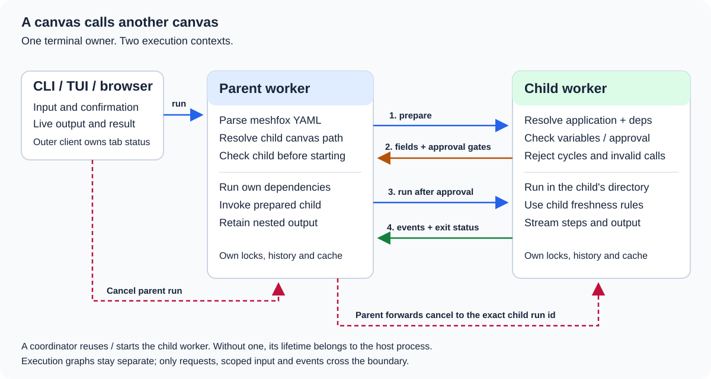
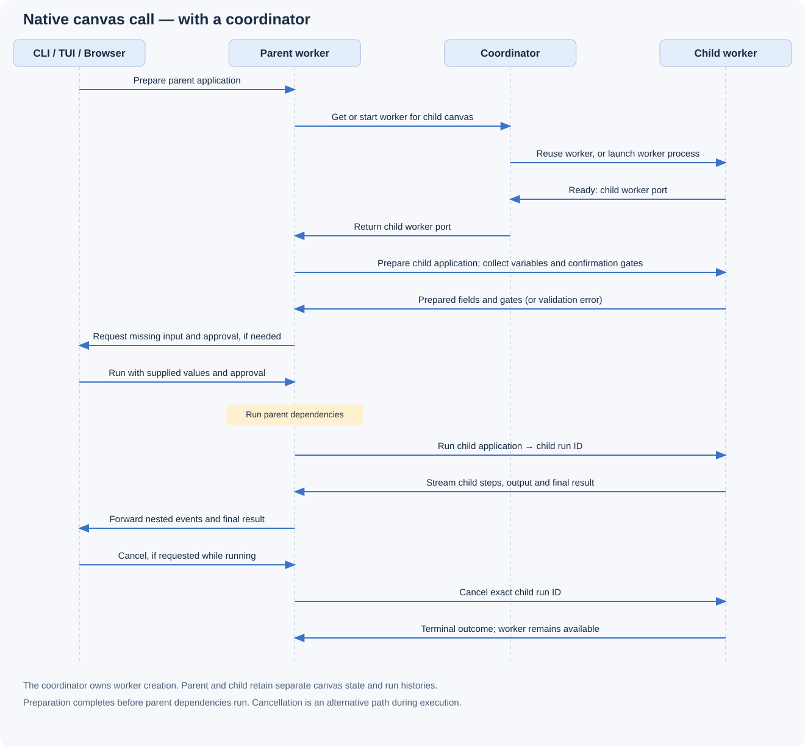
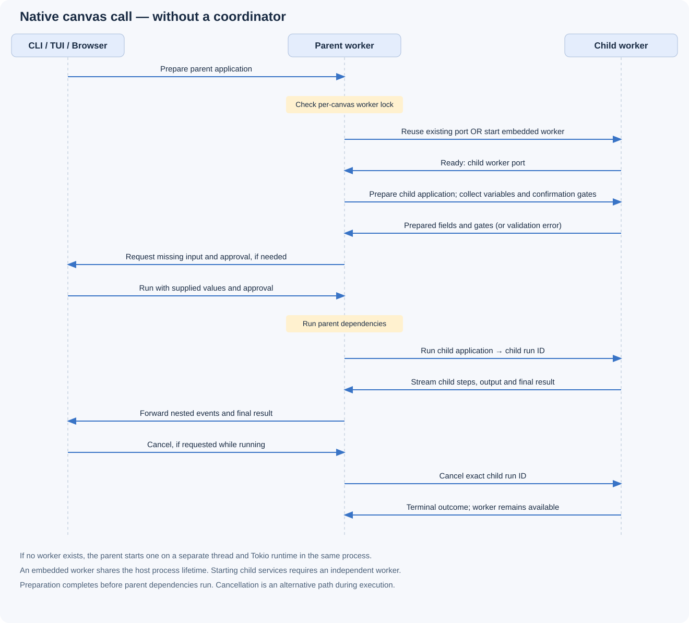

<!-- meshfox:canvas -->
# Calling another canvas
<!-- meshfox:node id="root" -->

A parent canvas calls an application in a separate child canvas using a native `meshfox` block. No nested shell command or second terminal-status owner is needed.

Open this example with the newly built meshfox, then run **Call with a value**. All commands below are safe: they print greetings and use a short sleep. No installation or network access is required.

```console
meshfox examples/canvas-call.canvas.md tui
meshfox examples/canvas-call.canvas.md run call-with-a-value
```

The child is [canvas-call-data/child.canvas.md](./canvas-call-data/child.canvas.md). This is a separate canvas, not an `include`: its working directory, variable cache, run history, locks and dependency chain remain its own.

## How the call works
<!-- meshfox:node id="how-the-call-works" -->



1. The outer CLI, TUI or browser sends a normal run request to the parent worker. The YAML is parsed against a strict schema; the child path is anchored to the document containing this block.
2. Before any parent dependency starts, the parent asks the child worker to prepare the application. Missing child variables become scoped fields in the parent's pre-run form. Child confirmation gates are included in the parent's approval request. Cycles are rejected here.
3. Once input and approval are available, the parent executes its own dependencies and starts the child application through its worker API. The child's `set` values are explicit overrides; its own planner, working directory, locks and freshness rules remain authoritative.
4. Structured child events are retained as parent output. Nested step banners identify the source canvas; CLI/TUI tab status can show `parent → child.canvas.md: step`. The child exit code becomes the parent step's exit code.
5. Cancellation uses the exact child's run id. It does not kill the child worker, unrelated runs, or all services.

The graphs are not merged. The parent invocation is rechecked even when its YAML is unchanged, so editing the child is not hidden by the parent's freshness record. Without a coordinator, a newly created child worker is embedded in the caller's process.

## Call with a value
<!-- meshfox:node id="call-with-a-value" -->

Run this node. `WHO` belongs to the child canvas; `set` supplies its value without a prompt. The output includes the child's greeting and working directory.

```meshfox name="call-with-a-value"
canvas: canvas-call-data/child.canvas.md
run: greet
set:
  WHO: native canvas call
fresh: true
```

The YAML is data, not shell code. `set` values are literal strings; shell expansion and implicit parent-variable interpolation do not occur.

## Ask for child input
<!-- meshfox:node id="ask-for-child-input" -->

On the first run, this child application needs `INPUT`. TUI and browser display the missing child variable in their own form; the CLI asks in its terminal. Non-secret answers are cached in the child canvas as usual, so later runs may no longer prompt.

```meshfox name="ask-for-child-input"
canvas: canvas-call-data/child.canvas.md
run: ask
```

For non-interactive use, supply the scoped field explicitly:

```console
meshfox examples/canvas-call.canvas.md run ask-for-child-input --set '@canvas[ask-for-child-input:ask-for-child-input]/INPUT=Ada'
```

## Try cancellation
<!-- meshfox:node id="try-cancellation" -->

This child prints a start message, waits 15 seconds, then prints a completion message. Stop the parent while it waits. The child completion message should not appear.

```meshfox name="try-cancellation"
canvas: canvas-call-data/child.canvas.md
run: slow
```

## Try a child failure
<!-- meshfox:node id="try-a-child-failure" -->

This is an intentional, harmless failure. The child exits with code 7; the parent block becomes failed, and `meshfox run` exits unsuccessfully.

```meshfox name="try-a-child-failure"
canvas: canvas-call-data/child.canvas.md
run: fail
```

## Current boundaries
<!-- meshfox:node id="current-boundaries" -->

Supported YAML fields are `canvas`, `run`, `set`, `fresh`, `no-deps` and `skip-fresh`. Unknown or duplicate fields are rejected. Bind required application arguments in `run`, for example `run: 'build install[DEST=local]'`.

Native calls do not relay interactive `tty` applications. Native fences cannot use `env`, `interpreter`, `service` or `tangle`; use `set` to pass child document variables. Calls starting services require an independently running child worker (open that canvas with `meshfox view`, or use a coordinator), so services cannot be orphaned by a one-shot caller exiting.

A child requiring approval still requires explicit approval of the parent invocation. There is no `confirm: true` YAML shortcut. Nesting is limited to 32 levels and cycles are rejected before execution.

## Child canvas
<!-- meshfox:node id="child-canvas" type="file" -->

[Open the child canvas](./canvas-call-data/child.canvas.md)

Inspect or run its applications directly to see their independent variable cache, run history and working directory.

## Sequence with a coordinator
<!-- meshfox:node id="sequence-with-a-coordinator" -->



The parent asks the coordinator for the child worker's port. The coordinator reuses an existing worker or launches a separate worker process; the parent then talks directly to the child worker.

Time flows downward. Input and approval are collected before parent dependencies run. Cancellation is an alternative path while the child is running: it targets the exact child run ID and leaves the worker available.

## Sequence without a coordinator
<!-- meshfox:node id="sequence-without-a-coordinator" -->



The parent checks the child's per-canvas worker lock. It reuses an existing worker, or starts an embedded child worker on a separate thread and Tokio runtime in the same process. The embedded worker shares the host's lifetime; child services require an independent worker.

Time flows downward. Input and approval are collected before parent dependencies run. Cancellation is an alternative path while the child is running: it targets the exact child run ID and leaves the worker available.

