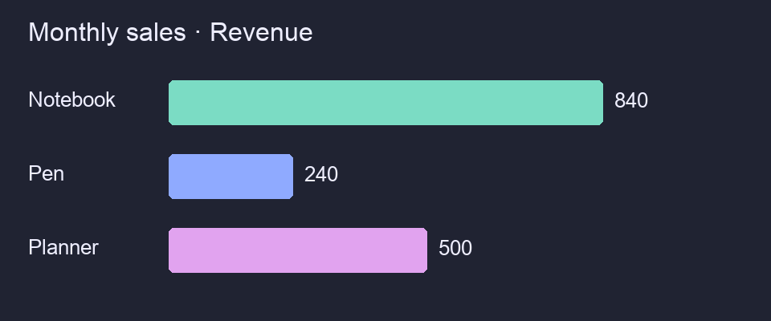

<!-- meshfox:canvas -->
# demo

**A working notebook, inside your terminal.**

Browse Markdown, find an instruction, run its code and edit the source.

| Step | Action |
| --- | --- |
| 1 | Find the sales report |
| 2 | Run and watch live output |
| 3 | Change region and run again |
| 4 | Edit a note and save |

<!-- meshfox:var name="REGION" default="North" -->

## Quick guide
<!-- meshfox:node id="quick-guide" color="blue" -->

**Everything stays beside the instruction.**

- Navigate with j / k
- Search with /
- Run with r
- Configure with c
- Edit source with e

No network access or external data needed.

## Monthly sales
<!-- meshfox:node id="monthly-sales" color="green" -->

Choose a region, then run this small local report.

```bash name="sales" env="$REGION"
printf '\033[36mLoading %s sales...\033[0m\n' "$REGION"
sleep 1
printf 'Checking 3 products...\n'
sleep 1
printf '\nProduct       Units    Revenue\n'
printf 'Notebook         42       840\nPen              80       240\nPlanner          25       500\n'
printf '\n\033[32mReport ready for %s. Total: 1580\033[0m\n' "$REGION"
```

The output streams directly below the code.

## Summary
<!-- meshfox:node id="summary" color="orange" -->

**From instruction to result.**

Images render right inside the document.

{width=100%}

Markdown + live code + parameters + images + source editing.

